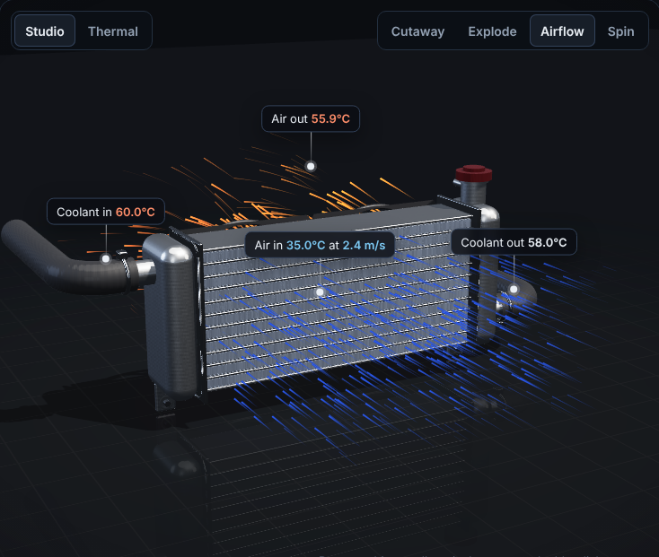
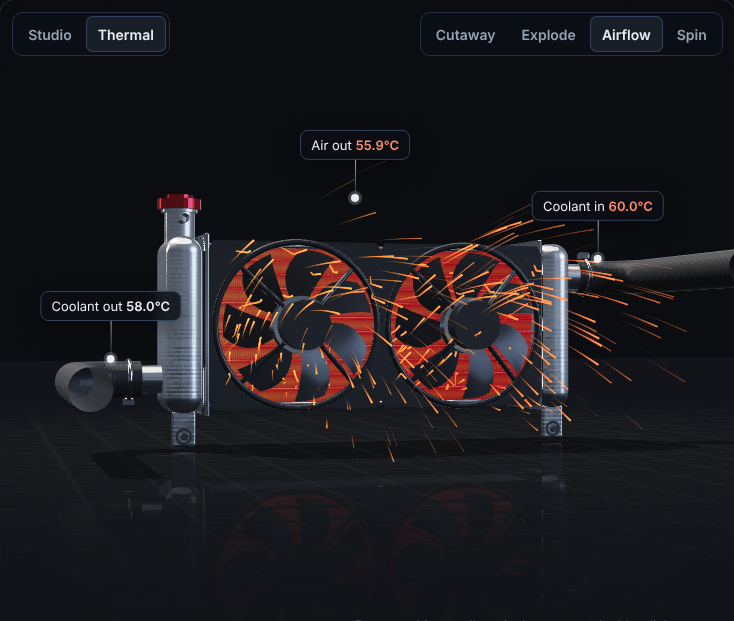

# Radiator Flow Lab

An interactive radiator simulator for a 9.25 × 4.5 × 2 in louvered-fin core. Every slider or typed number updates the 3D model, the airflow and coolant flow, a live fluid simulation of air through the louvers, and the full set of thermal and pressure figures.



## What it does

- **3D model**: real-time WebGL2 rendering of the core: wavy louvered fins, flat tubes, rounded tanks, TIG welds, hoses, clamps and fans. It has realistic metal lighting, shadows and a reflective floor. Air and coolant are drawn as animated streaks colored by temperature. There are Studio, Thermal, Cutaway and Explode views.
- **Live louver flow**: a lattice Boltzmann (D2Q9) fluid solver running in a Web Worker on a 2D slice through the fins. It shows speed, temperature or vorticity and measures flow efficiency (duct-directed vs louver-directed flow).
- **Calculator**:
  - Chang & Wang (1997) j-factor and Kim & Bullard (2002) friction factor.
  - Fin efficiency.
  - Laminar and Gnielinski coolant-side heat transfer.
  - ε-NTU for crossflow with both streams unmixed.
  - In "Drive it" mode, airflow solved from vehicle speed, duct pressure recovery and a fan curve.
- **Extras**: core face heat map with a probe, performance charts (speed, louver angle, fin density), baseline compare, SI/US units, presets, validity flags.



## Run it

It's a single static file with no build step and no dependencies. Open `index.html` in a browser, or host it anywhere.

### GitHub Pages

1. Push this repo to GitHub.
2. Go to **Settings → Pages**, set **Source** to *Deploy from a branch*, then pick `main` and `/ (root)`.
3. The site appears at `https://<your-username>.github.io/<repo-name>/`.

## Editing

The readable source is in `src/`:

| File | What it holds |
|---|---|
| `src/index.src.html` | Page layout and CSS |
| `src/physics.js` | Radiator thermal-hydraulic model |
| `src/lbm.js` | Lattice Boltzmann louver solver |
| `src/render3d.js` | WebGL2 3D renderer and geometry |
| `src/app.js` | Controls, charts, face map, wiring |

After editing, rebuild the single-file page:

```
python3 build.py
```

## Accuracy

These are correlation-based estimates for design exploration, typically within about ±15–25% inside the correlations' test ranges. The 2 in core is deeper than the cores behind the friction correlation, so treat pressure drop and the solved airflow as estimates; the page flags this. The louver slice is 2D, so use it for flow regime and angle, not absolute pressure drop. Confirm designs with CFD and test data.
